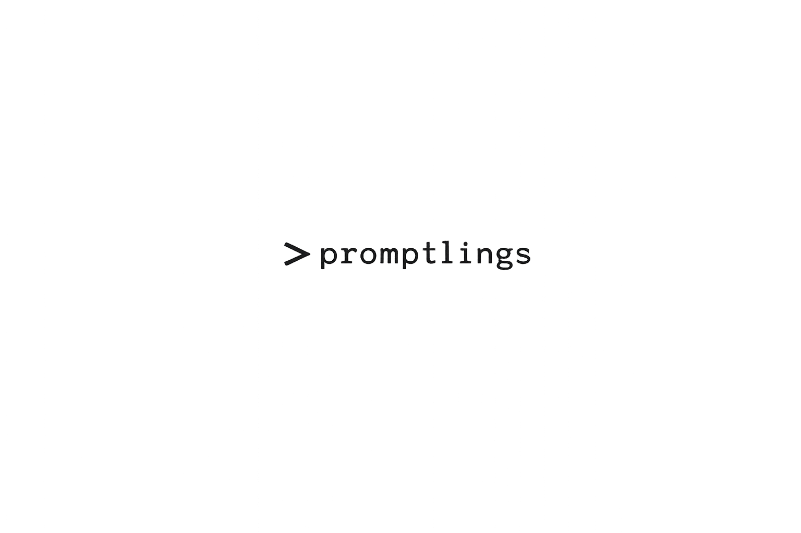

<p align="center">
  <picture>
    <source media="(prefers-color-scheme: dark)" srcset="logo-dark.png">
    
  </picture>
</p>

Custom agents and reusable skills for coding assistants. Use them to review a
pull request, work through a technical problem, carry context between sessions,
or make a technical demo.

Agents are Markdown files that define a role and its working rules. Skills
provide methods an agent can load for a particular task. They run in your
assistant, including GitHub Copilot CLI and Claude Code.

## Choose an agent

| Agent | What it does |
| --- | --- |
| [the-nitcracker](agents/code-review/the-nitcracker.agent.md) | Reviews a PR with inline findings and a narrative explaining the change, its design choices, and its assumptions. |
| [PR Walkthrough](agents/code-review/pr-walkthrough.agent.md) | Maps a PR's architecture and important decisions before you review the diff. Read-only, with output in conversation. |
| [Sparring Partner](agents/reasoning/sparring-partner.agent.md) | Works through designs, debugging hypotheses, implementation plans, and testing questions with you. |
| [Memory Manager](agents/context/memory-manager.agent.md) | Saves session context to Basic Memory and retrieves earlier decisions and unfinished work. |
| [Technical Demo](agents/media/technical-demo.agent.md) | Produces a technical explainer or hands-on demo, from story and script approval through recording, narration, and review. |
| [BMAD Orchestrator](agents/orchestration/bmad-orchestrator.agent.md) | Guides software delivery through the installed BMAD workflows. |
| [Spec-Kit Flow](agents/orchestration/speckit-flow.agent.md) | Guides software delivery through Spec-Kit specifications, plans, tasks, implementation, and acceptance. |

[Artifact Inspector](agents/maintenance/artifact-inspector.agent.md) is a
maintainer and CI helper for inspecting agent and skill definitions.

## Install

The installer selects all agents and the supporting toolchain by default,
including Basic Memory, BMAD, Spec-Kit, browser automation, and video tools.
It prints a plan and asks for approval before installing.

**PowerShell**

```powershell
irm https://raw.githubusercontent.com/dfinson/promptlings/main/install.ps1 -OutFile install.ps1
powershell -ExecutionPolicy Bypass -File .\install.ps1
```

**Bash**

```bash
curl -fsSL https://raw.githubusercontent.com/dfinson/promptlings/main/install.sh -o install.sh
bash install.sh
```

For just the two review agents and bundled Promptlings skills, using an existing
Node.js installation:

```powershell
powershell -ExecutionPolicy Bypass -File .\install.ps1 -Review -NoDependencies -NoReadSide
```

```bash
bash install.sh --review --no-dependencies --no-readside
```

Restart your assistant after installation. See the [installation guide](docs/installation.md)
for supported systems, component selection, manual installation, and the Claude
Code plugin.

BMAD and Spec-Kit also need [initialization in each repository or worktree](docs/bmad-setup.md).
Memory Manager can help set up Basic Memory project routing.

## Try it

Select an agent in your assistant and give it a task:

```text
Walk me through this PR before I review it.
Help me work out why this test passes locally but fails in CI.
Save this session so I can pick it up in another worktree.
Make a demo explaining this change to a new contributor.
```

The [skills directory](skills/) also contains methods for investigation, test
analysis, writing, narration, and design documents. You can ask your current
agent to use one without switching personas.

### Review ensemble

To combine the reviewers, ask your current coding agent:

```text
Run the review ensemble on this branch against origin/main.
```

The [review-ensemble](skills/review-ensemble/SKILL.md) skill runs the-nitcracker,
PR Walkthrough, and the host's built-in rubber-duck independently in parallel.
Your current agent investigates their findings and brings the results together.
The host must support parallel subagents and provide all three identities.

For Claude Code, or another host without rubber-duck, install Sparring Partner
and choose it explicitly:

```text
Run the review ensemble with Sparring Partner instead of rubber-duck.
```

Review returns analysis. To have verified issues repaired too, ask for that:

```text
Run the review ensemble on my staged and unstaged changes, fix the verified in-scope issues, and verify the repairs.
```

Review does not authorize posting comments, approving, or merging.

## Example output

The [examples](examples/) contain a review and a walkthrough of the same real
pull request. They disagree about whether a code path is reachable. Read them
side by side to see what the agents produce and why findings still need checking.
The examples include reproduction instructions and disclose a wording edit.

## Contributing

Keep each agent's responsibility explicit. Put reusable methods in skills
rather than adding another persona for every task. See the
[contributor guide](docs/contributing.md) for checks, review regression cases,
and design provenance.

## License

[Apache 2.0](LICENSE).
